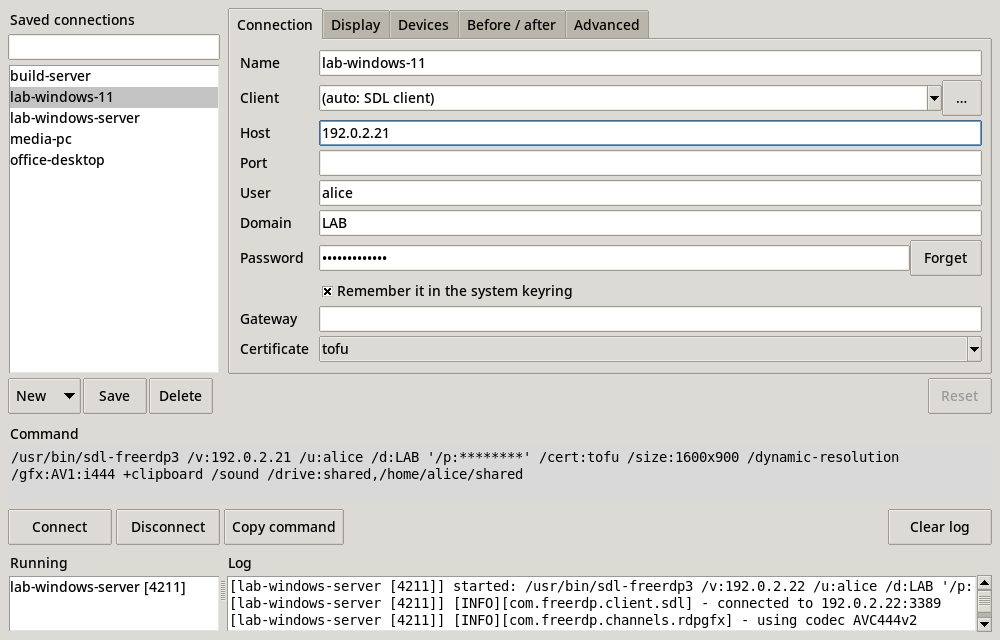

# freerdp-tk

A small launcher window for the [FreeRDP](https://www.freerdp.com/) 3 SDL client, with the client inside.
It runs on Linux, Windows and macOS: `uvx freerdp-tk` brings everything it needs, the client, Python with Tkinter and the [keyring](https://pypi.org/project/keyring/) package.



- **Saved connections:** a list you can filter. Double-click one to connect, or select several and connect them all at once.
- **Changes stay visible:** what you changed lights up, on its label, on its tab and in the list, until you save it. *Reset* goes back to what is saved, and moving on to another connection, or closing the window, asks whether to save or discard. *New* starts an empty connection or a copy of this one.
- **Finds the client for you:** "(auto)" takes the client that came with freerdp-tk, then the first FreeRDP 3 SDL client on your `PATH` (`sdl-freerdp`, `sdl-freerdp3`, `sdl3-freerdp`), then one in a local build tree, passing over any that is not FreeRDP 3 or does not start. On `PATH`, its order decides, whatever the names: a release that puts its own `bin/` first gets its own client, not the system's. The SDL client is the one FreeRDP actively develops, and the same on Linux, Windows and macOS. You can still pick another FreeRDP 3 program with *…*.
- **Form instead of flags:** display, monitors (*List…* asks the client which ones it sees, then you tick them; the remote desktop gets them as separate screens, or as one big screen with `/span`), graphics codec (including AV1 and AV2), clipboard, sound, microphone, drive sharing, log level, plus a box for extra arguments.
- **Live command preview:** shows the exact command line, with the password hidden, and copies it for you.
- **Session log:** runs several sessions at once and shows each client's output.
- **Four languages:** English, 中文 (Chinese), 日本語 (Japanese) and Français (French). The window starts in the system's language; the button beside *Clear log* picks another one, from the next start, and `FREERDP_TK_LANG=fr` sets one for a single run. The log stays in English, so it can be searched and pasted into a bug report.

## Install

```bash
uvx freerdp-tk               # run it once, without installing
uv tool install freerdp-tk   # or install it: then just freerdp-tk (pipx install freerdp-tk works too)
```

That is all: the wheel for your platform carries the FreeRDP SDL client, one program of about 25 MB.

| Platform | Client in the wheel |
|----------|---------------------|
| Linux x86_64, aarch64 | yes, with glibc 2.34 or newer (RHEL 9, Debian 12, Ubuntu 22.04, Fedora 35 and newer) and PulseAudio's `libpulse.so.0`, which every desktop has (else `sudo apt install libpulse0`) |
| macOS 12 and newer, Apple Silicon and Intel | yes |
| Windows 10 and 11, x86_64 and ARM64 | yes |
| Anything else (musl, an older glibc, a BSD) | no: the same freerdp-tk without a client, see below |

Auto takes the wheel's client first: it is the one this release was tested with, and a distribution's client is often older (no AV1). A client you installed yourself is one pick away under *Connection → Client*, and auto falls back to it when the wheel has no client, or its client is not FreeRDP 3 or does not start. To install one, or where no wheel has a client:

| Platform | Client |
|----------|--------|
| Debian / Ubuntu | `sudo apt install freerdp3-sdl` |
| Fedora | `sudo dnf install freerdp` |
| macOS | `brew install freerdp` |
| Windows | a FreeRDP 3 build containing `sdl-freerdp.exe`, on your `PATH` |

**About that client:** it is a portable build from [rdp-release-kit](https://github.com/congzhangzh/rdp-release-kit), unofficial and a preview: FreeRDP's master plus open pull requests, with AV1, AV2 and Opus. `client.lock` pins the release and its SHA-256. It decodes H.264 through the system on macOS (VideoToolbox) and Windows (Media Foundation). On Linux it has no H.264, since it carries neither OpenH264 nor FFmpeg: leave the codec on its default, pick *AV1*, *AV2* or *progressive*, or use a client of your own. AV1 and AV2 need a client built with them, such as this one; a distribution's FreeRDP refuses them ("Command line parsing failed at 'gfx'"). `freerdp_tk/client/` in the installed package holds its `MANIFEST` (what it was built from) and `licenses/`, one folder per component.

**Tk:** the window needs a Python with Tk. The Pythons that `uv` installs include it; a Linux system Python often does not (`sudo apt install python3-tk`, `sudo dnf install python3-tkinter`). `uv` takes the system Python when there is one, so:

- started by `uvx`, freerdp-tk notices a Python without Tk and starts again with uv's own Python (it downloads one the first time); `uvx --managed-python freerdp-tk` goes there directly;
- installed with `uv tool install`, use `uv tool install --managed-python freerdp-tk` on such a system;
- anywhere else, it says what to install and exits.

On Linux, the Tk in uv's Pythons draws with the X core fonts (it is built without Xft), which often lack `…` and `•`: freerdp-tk then shows `...` and `*` instead.

## Passwords

- **Saved in the system keyring, never in a file.** With *Remember it in the system keyring* ticked (the default), the password goes to the system's own store: Credential Manager on Windows, the Keychain on macOS, the Secret Service (GNOME Keyring, KeePassXC) or KWallet on Linux. From then on a double-click connects without asking. The connections file only keeps whether the box is ticked.
- The password dialog has the same box: untick it, and the password stays in memory only, until the window closes. *Forget* removes a saved password. Deleting a connection removes its password too, unless another saved connection logs in to the same account.
- **A rejected password is asked for again.** When the client exits because the server turned the password down (exit codes 132, 134, 154 and 159 of the SDL client), freerdp-tk asks for another one and connects again; with the box ticked, the new password replaces the saved one. A locked, expired or disabled account is not asked again, since another password would not help.
- An entry is named after the account it logs in to, `freerdp-tk/<domain\user>@<host>:<port>`, not after the connection. Renaming a connection keeps its password, and two connections to one account share it.
- **No usable keyring** (on Linux: no Secret Service or KWallet, or no D-Bus session, as over plain SSH): the box is greyed out with the reason, and passwords are asked for and kept in memory only. freerdp-tk never falls back to a file. A locked keyring is unlocked through the system's own prompt; if that fails or is cancelled, freerdp-tk asks for the password instead. The keyring is used from a thread of its own, so a slow one (an unlock prompt, a Secret Service that D-Bus takes two minutes to give up on) never freezes the window.
- **What the keyring protects:** the password on disk, and from the other users of the computer. A program that runs as you can usually read it: Credential Manager and an unlocked Secret Service hand it to any process of your session, while the Keychain asks you first unless the program is on the entry's access list.
- All arguments are passed to the client through standard input (`/args-from:stdin`), so the password never appears in the process list (`ps`, Task Manager). FreeRDP 2 has no such option, so freerdp-tk refuses to start a FreeRDP 2 client rather than put the password on its command line.

## Before and after commands (SSH tunnels and more)

The *Before / after* tab runs your own commands around a session:

- **Before connecting:** runs to the end before the client starts; if it fails, the client does not start. Tick *Keep it running during the session* for a command that stays up beside the session, such as a tunnel.
- **Then wait until:** holds the client back until whatever the command started is ready, whether the command ran to its end or keeps running:
  - *a port answers*, for `host:port`, such as `127.0.0.1:%L`.
  - *the output shows*, for a regular expression matched against each line of the before command's output, such as `listening on .*%L`. A placeholder here stands for its literal value. Lines only arrive once the program writes them, and many programs hold back their output when it goes to a pipe.
  - *seconds have passed*, for a fixed pause, when nothing can be checked.
- **Give up after:** the seconds the whole before step may take, from the start of the command; then the client does not start, and a command that was to run to its end is stopped. Left empty, a port or output wait gives up after 30 seconds and the command itself has no limit. A fixed pause always lasts as long as asked.
- **Stop it when the session ends:** ends the before command and everything it started, also if freerdp-tk itself crashes or is killed:
  - **Linux:** a small supervisor runs the command as a *child subreaper*, so even daemons that fork twice and leave the process group stay under it. Each is sent SIGTERM, then SIGKILL after 3 seconds.
  - **Windows:** the command runs in a job object that the system closes, and with it everything inside, when freerdp-tk lets go of it.
  - **macOS:** the same supervisor, but macOS has no subreaper: a daemon that forks twice and leaves the process group survives.
- **After disconnecting:** runs once the session is over, however it ended.
- **Client proxy:** passed to the client as `/proxy:`.

Placeholders work in all of these and in the extra arguments: `%h` host, `%p` port, `%u` user, `%L` a free local port picked for this session, `%%` a percent sign.

**Fill in: SSH tunnel…** sets it all up for the common case. It asks for a jump host and fills in:

```
before:      ssh -N -D 127.0.0.1:%L -o ExitOnForwardFailure=yes -o BatchMode=yes me@bastion
wait until:  127.0.0.1:%L
proxy:       socks5://127.0.0.1:%L
```

The RDP server then only has to be reachable from the jump host, and the client still connects by its real name, so the certificate check is unchanged. ssh runs without a terminal, so it must log in with a key or an agent, and it must already know the jump host's key (connect once with `ssh` in a terminal).

## Hotkeys

The SDL client takes a few keys for itself: a modifier plus *Enter* (fullscreen), *R* (resizable), *G* (grab the keyboard), *M* (minimize) and *D* (disconnect). Its own default modifier is Right Shift, so a capital D typed with the right Shift key would end the session.

So when freerdp-tk starts and the client's settings file does not exist yet, it writes one that moves the modifier to Right Alt + Right Shift (Right Option + Right Shift on a Mac):

```json
{ "SDL_KeyModMask": ["KMOD_RALT", "KMOD_RSHIFT"] }
```

The file is `sdl-freerdp.json` in `~/.config/freerdp/` (Linux, macOS; `$XDG_CONFIG_HOME` if set) or `%APPDATA%\freerdp\` (Windows). It belongs to the client, so it holds for every session of an SDL client on that account, also without freerdp-tk. An existing file is never changed, so a file without `SDL_KeyModMask` keeps Right Shift. To change the keys, edit the file; deleting it only brings this one back. A user file also takes precedence over a system-wide `SDL_KeyModMask`.

## Where things are kept

| What | Where |
|------|-------|
| Saved connections | `~/.config/freerdp-tk/profiles.json` (Linux), `~/Library/Application Support/freerdp-tk/` (macOS), `%APPDATA%\freerdp-tk\` (Windows) |
| Extra FreeRDP source trees to search for built clients | `FREERDP_TK_TREES`, separated like `PATH`. `~/projects/FreeRDP` is always searched. |

## Limitation

The client runs without a terminal, so it cannot ask questions while connecting, such as whether to trust a new certificate. Pick a certificate policy (`tofu`, `ignore` or `deny`) on the Connection tab instead. The default, `tofu`, trusts a server's certificate the first time you connect.

## Development

```bash
uv run --with-editable . python -m freerdp_tk   # run from the checkout
uv build                                         # build the sdist and wheel into dist/
```

The screenshot above is rendered from demo data in a virtual X server, so no real hosts end up in it. Regenerate it after changing the UI:

```bash
xvfb-run -s "-screen 0 1400x1000x24" \
    uv run --with pillow --with-editable . python scripts/screenshot.py docs/screenshot.png
```

### Releasing to PyPI

Releases are published by GitHub Actions through [trusted publishing](https://docs.pypi.org/trusted-publishers/), so no API token is needed. The version is taken from the git tag.

One-time setup:
1. On PyPI, open *Your projects → Publishing → Add a new pending publisher* and enter: project `freerdp-tk`, owner `congzhangzh`, repository `freerdp-tk`, workflow `release.yml`, environment `pypi`.
2. On GitHub, create an environment named `pypi` (*Settings → Environments*).

Each release after that:

1. In `src/freerdp_tk/RELEASE_NOTES.md`, rename the section "Unreleased" to the release's version, commit and push to `main`, and wait until its tests pass.
2. Tag that commit and push the tag:

```bash
git tag 20261107.1          # yyyymmdd.index, the index counting that day's releases from 1
git push origin 20261107.1
```

Only a tag of this form starts the release; the tests run on every push to `main`. The release waits for the tests of its commit and stops, before anything is published, when they failed or when the notes have no section for its version. A tag whose release failed stays as it is: fix it and tag the next index.

The workflow builds the package, adds the client to one wheel per platform (`scripts/bundle_client.py`), checks on a runner of each platform that the wheel installs and its client starts, and then uploads them all to PyPI, with the plain wheel and the sdist. Then it makes the GitHub release, with that version's notes and the same files. The window shows the version in its title, and the notes under *About*.

To move to a newer client, pin a release of rdp-release-kit and commit `client.lock`:

```bash
python scripts/bundle_client.py --pin 20261106.3
```

## License

Apache-2.0, the same license as FreeRDP.
